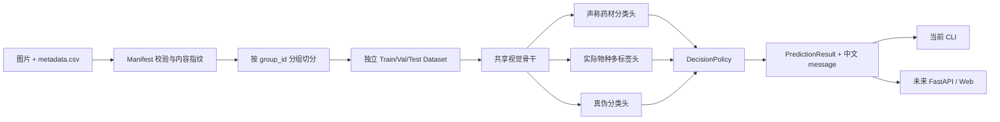

# 中药识别三任务架构重构设计

## 1. 背景

现有项目使用 PyTorch 对中药图片进行单标签分类，标签由文件夹名称隐式提供，例如“当归_真品”。本次重构的首要目标不是在缺少真实数据时追求不可验证的准确率，而是建立正确、可复现、可测试、易维护的工程基础。

现状审查已经确认以下风险：

- 训练、验证和测试子集共享同一个 `ImageFolder` 实例，后创建的数据加载器会覆盖先前数据集的 `transform`。
- 默认冻结骨干网络后再解冻的调用条件写反，默认流程实际不会解冻。
- checkpoint 缺少类别名称、预处理、模型结构和拒识策略，推理依赖当前数据目录猜测类别。
- 训练、评估和推理直接依赖脚本级路径，未来 Web 入口无法安全复用。
- 当前解释器混用了 Anaconda 与用户级 `site-packages`，导入 PyTorch 会触发重复 OpenMP 运行时冲突。
- 项目没有自动化测试。

## 2. 目标与非目标

### 2.1 目标

- 分别输出声称药材、实际物种和真伪状态。
- 对合法但低置信度或疑似分布外的输入返回“无法确定”，不强制分类。
- 默认向用户显示统一中文结论；三个任务均达到阈值且识别为正品时显示“此药品为正品（置信度：92.3%）。”，详细字段保留在结构化结果中。
- 使用显式数据清单，按最高相关单元切分数据，阻止实体、批次、来源或拍摄会话泄漏。
- 建立自描述、严格校验、可恢复训练的新版 checkpoint。
- 将核心逻辑与 CLI 分离，为未来 FastAPI 上传页面保留稳定服务接口。
- 在重量级依赖导入前检查解释器、依赖来源、设备、路径和编码。
- 建立单元测试、小型集成测试和 CLI 冒烟测试。
- 保留旧权重文件，但不猜测式兼容旧单头 checkpoint。

### 2.2 非目标

- 本版不实现 FastAPI、浏览器页面、数据库、任务队列或用户系统。
- 本版不使用假数据训练或覆盖现有权重。
- 在真实数据、校准集和独立测试集到位前，不宣称阈值已经校准或达到任何准确率。
- 本版不把有限未知样本训练成“万能 unknown 类”。
- 本版不引入实验平台、模型注册中心或分布式训练。

## 3. 总体架构

核心代码放入 `项目/Files/herb_authentication/` Python 包。现有 `train.py`、`evaluate.py` 和 `predict.py` 改为薄入口，新增 `doctor.py` 与独立的 `calibrate.py`；校准入口只使用 locked known validation 与 unknown calibration，永不读取 test role 或原地修改输入 checkpoint。



建议模块：

```text
项目/Files/
├── herb_authentication/
│   ├── __init__.py
│   ├── config.py
│   ├── encoding.py
│   ├── environment.py
│   ├── errors.py
│   ├── data/
│   │   ├── manifest.py
│   │   ├── splitting.py
│   │   └── datasets.py
│   ├── models/
│   │   └── multitask.py
│   ├── training/
│   │   ├── checkpoints.py
│   │   ├── losses.py
│   │   ├── metrics.py
│   │   └── trainer.py
│   └── inference/
│       ├── results.py
│       └── service.py
├── doctor.py
├── calibrate.py
├── train.py
├── evaluate.py
└── predict.py
tests/
├── unit/
└── integration/
```

数据模块不创建模型，模型模块不读文件，推理服务不解析命令行，CLI 不复制业务规则。

## 4. 已知数据契约

### 4.1 `metadata.csv`

每张图片对应一行。字段定义如下：

| 字段 | 必填 | 含义 |
|---|:---:|---|
| `image_path` | 是 | 默认相对于 `metadata.csv` 所在目录；配置了 `data_root` 时相对于该目录，规范化后不得越界 |
| `group_id` | 是 | 最高相关单元，例如同一采购批次、来源批次或拍摄会话；任何可能共享背景、包装、设备或批次纹理的数据必须同组 |
| `sample_id` | 是 | 物理实体；同一实体的多角度照片共享该值，并且必须从属于同一个 `group_id` |
| `claimed_herb_name` | 是 | 产品声称或冒充的药材品类，例如“当归” |
| `authenticity` | 是 | 只允许 `authentic` 或 `counterfeit` |
| `actual_species` | 否 | 经专业鉴定的实际物种；多个物种用 `|` 分隔；缺失表示未知，不伪造监督标签 |
| `species_annotation_status` | 否 | `verified`、`unverified` 或 `not_applicable`；实际物种参与训练时必须为 `verified` |

可选追溯字段包括 `batch_id`、`origin`、`capture_device`、`collected_at`、`annotator` 和 `notes`。

```csv
image_path,group_id,sample_id,claimed_herb_name,authenticity,actual_species,species_annotation_status
raw/batch_01/sample_0001/image_01.jpg,batch_01,sample_0001,当归,authentic,当归,verified
raw/batch_01/sample_0001/image_02.jpg,batch_01,sample_0001,当归,authentic,当归,verified
raw/batch_02/sample_0002/image_01.jpg,batch_02,sample_0002,当归,counterfeit,欧当归,verified
```

声称药材头回答“它以什么药材身份出现”；实际物种头回答“专业标签显示它实际包含什么物种”；真伪头回答“它与声称品类是否一致并符合正品标准”。

### 4.2 校验

训练前集中检查：

- 必填字段、枚举、空值、控制字符和 Unicode 规范化。
- 图片存在、可读取、格式与像素尺寸合理。
- 重复行、重复路径、内容哈希完全重复及可配置的感知哈希近重复。
- 同一 `sample_id` 的 `group_id`、声称药材和真伪标签一致。
- 每个 `group_id` 只能对应一个“声称药材 × 真伪”组合；混合业务批次必须拆成更精确的最高相关组。
- 每个组合至少有 3 个独立 `group_id`；不足时失败并列出缺口。少于 10 个组时允许开发切分，但发出评估不稳定警告。
- 所有验证/测试中的已知声称药材都在训练集中出现。

失败时生成 UTF-8 `validation_report.json` 并停止，不静默跳过损坏数据。

### 4.3 分组切分

- 默认比例为训练 0.7、验证 0.2、测试 0.1。
- 先将记录折叠为按 `group_id` 的组表，再以“声称药材 × 真伪”为分层标签。
- 每个分层使用固定 seed 对规范化、排序后的组 ID 洗牌；使用最大余数法分配组数，并保证三个分区各至少一个组。
- 组数不足、出现混合分层组或无法保证每个分区有目标组合时必须失败，不自动退化为图片级切分。
- 分区展开回图片行后，再检查 `group_id`、`sample_id`、内容哈希和近重复图均无跨分区交集。
- 保存算法版本、seed、规范化 manifest 指纹和图片内容哈希，输出 `train.csv`、`val.csv`、`test.csv`。

实际物种类别表只由训练分区中 `verified` 的标签生成，先做 Unicode NFC 规范化，再按确定性 Unicode 顺序排序。验证或测试出现训练未见物种时按 unknown-species 评估，不能扩展类索引。真伪类别顺序固定为 `['authentic', 'counterfeit']`。

### 4.4 Dataset 隔离

训练、验证和测试分别创建数据集实例，各自持有独立 transform。训练使用随机增强；验证、测试和推理使用确定性预处理。禁止多个 `Subset` 修改同一个底层数据集的 transform。

## 5. 未知与校准数据契约

开放集和难例使用独立 `unknown_metadata.csv`，至少包含：

| 字段 | 含义 |
|---|---|
| `image_path` | 与已知数据相同的安全路径规则 |
| `group_id` / `sample_id` | 与已知数据相同的隔离语义 |
| `unknown_type` | `unknown_herb`、`blurred`、`occluded`、`other_ood` 等 |
| `dataset_role` | 只允许 `calibration` 或 `test` |

`calibration` 与 `test` 的 group、sample、内容哈希和近重复图不得相交，也不得与已知数据各分区相交。已知验证集用于温度缩放等概率校准，unknown calibration 用于选择拒识阈值；已知测试集和 unknown test 只用于锁定策略后的最终评估，禁止调参。

## 6. 三任务模型

共享视觉骨干输出特征向量，并连接三个头：

```text
feature -> claimed herb head       -> multiclass logits
        -> actual species head     -> multilabel logits
        -> authenticity head       -> binary-class logits
```

骨干网络通过注册表创建，预训练权重使用 torchvision 权重枚举。测试通过依赖注入使用轻量编码器，不下载权重。

总损失为：

```text
total_loss = claimed_herb_weight * claimed_herb_cross_entropy
           + authenticity_weight * authenticity_cross_entropy
           + species_weight * masked_species_bce_with_logits
```

实际物种 loss 只对 `species_annotation_status=verified` 且物种在训练 taxonomy 中的样本计算；一个 batch 没有物种监督时，该项为零但保留可微的总损失。三个任务分别计算类别权重，所有损失权重经过配置校验并写入 checkpoint。

冻结语义：

- `freeze_backbone=true` 时先训练三个头，到 `unfreeze_epoch` 解冻骨干并切换到较低微调学习率。
- `freeze_backbone=false` 时从第一轮训练全模型，不执行延迟解冻。
- 优化器参数组、调度器和恢复状态必须与冻结阶段一致。

## 7. 训练与评估

每轮同时记录 image-level 和 sample-level 指标。多视角 sample-level 预测先对同一 `sample_id` 的概率取平均，再计算：

- 声称药材 loss、accuracy、macro-F1。
- 真伪 loss、accuracy、macro-F1，以及 counterfeit precision、recall、F1。
- 实际物种在 `verified` 子集上的 micro/macro-F1 与 mean average precision。
- 声称药材与真伪同时正确的联合准确率。
- 按声称药材分组的真伪指标。

默认模型选择分数为所有已启用且具有足够监督的任务之 sample-level macro-F1 调和平均，避免某一任务坍塌仍被算术平均掩盖。实际物种监督覆盖率不足配置阈值时只报告、不参与选择。置信区间按 `group_id` bootstrap，不能把同一实体的多张图片当成独立样本。

评估输出 UTF-8 JSON、UTF-8-SIG CSV 和必要图表。没有真实测试数据时只运行结构与流程测试，不生成性能结论。

## 8. 校准与拒识策略

- 已知验证集分别拟合三个头的概率校准参数并写入 checkpoint。
- unknown calibration 与已知验证集共同选择声称药材和真伪拒识阈值；实际物种使用多标签阈值，若无物种达到阈值则整体拒绝判断。
- 独立 `calibrate.py` 将校准参数和阈值原子写入新的 calibrated checkpoint；输入 checkpoint、已知 test、unknown test 与两个旧模型只读。没有完整校准数据或无可行阈值组合时不得生成 `is_calibrated=true` 的产物。
- 阈值只能从校准集预测置信度的有序唯一值及边界值中搜索，禁止使用 test 数据调参。候选阈值组合必须同时满足可配置的 `max_unknown_accept_rate`（默认 `0.05`）和 `min_known_selective_accuracy`（默认 `0.95`）；在可行候选中依次选择 known coverage 最大、选择性准确率更高、unknown accept rate 更低、阈值三元组按字典序更高的组合，保证结果确定且偏向安全。若没有可行组合，则保持 `is_calibrated=false` 并 fail closed。
- 只有声称药材、实际药材和真伪状态三个结果都达到各自阈值时，才能输出正品或伪品；实际药材无法确定时返回“无法判断该药品的实际药材及真伪，请人工复核。”。
- 阈值锁定后，在 known test + unknown test 报告 known reject rate、unknown accept rate、AUROC/AUPR、FPR95、coverage-risk 和选择性准确率。
- 没有完整校准数据时 `is_calibrated=false`。普通推理默认 fail closed，返回“模型尚未完成真实数据校准，请人工复核。”；只有显式开发参数 `--allow-uncalibrated` 可以查看原始预测，且文案不得声称正品或伪品。
- 用户文案中的百分比使用校准后的真伪类别置信度，按一位小数显示；它是本次预测的置信度，不得称为测试集“准确度”。未校准结果不得显示百分比。
- 合法图片但声称药材、实际药材或真伪任一置信度不足时返回 `PredictionResult(rejected=true)` 与具体原因。

无效、损坏、超限或无法解码的图片抛出 `InputImageError`；checkpoint schema 或结构不兼容抛出 `CheckpointCompatibilityError` 并导致服务初始化失败。这些工程错误不能伪装成模型拒识。

## 9. 推理返回与中文文案

`InferenceService.predict_image()` 接受 `Path` 或图片字节并返回版本化 `PredictionResult`：

```json
{
  "schema_version": 1,
  "model_version": "multitask-v1",
  "is_calibrated": true,
  "message": "此药品为伪品（置信度：88.1%），声称为‘当归’，实际应为‘欧当归’。",
  "disclaimer": "模型结果不能替代专业鉴定。",
  "claimed_herb": {"label": "当归", "confidence": 0.923},
  "actual_species": [{"label": "欧当归", "confidence": 0.847}],
  "authenticity": {"label": "counterfeit", "confidence": 0.881},
  "rejected": false,
  "rejection_reasons": []
}
```

`ResultFormatter` 集中生成精确文案：

- 正品且实际药材确定：`此药品为正品（置信度：{authenticity_confidence:.1%}）。`
- 伪品且实际药材确定：`此药品为伪品（置信度：{authenticity_confidence:.1%}），声称为‘{claimed_herb}’，实际应为‘{species_list}’。`
- 实际药材无法确定：`无法判断该药品的实际药材及真伪，请人工复核。`
- 实际药材无法确定时必须设置 `rejected=true`，不得显示正品、伪品或百分比。
- 模型拒识：`无法确定此药品的种类或真伪，请人工复核。`
- 未校准：`模型尚未完成真实数据校准，请人工复核。`

CLI 和未来 Web 默认展示精确 `message`，并单独展示固定 `disclaimer="模型结果不能替代专业鉴定。"`，同时保留其他结构化字段；免责声明不得拼入或改变用户确认的业务结论文案。

## 10. Checkpoint 契约

新版 checkpoint 使用显式 `schema_version`，保存：

- 骨干、三个头、类别数量、`claimed_herb_classes`、`actual_species_classes` 和固定真伪类别顺序。
- 图像尺寸、归一化、预处理版本、损失权重、校准方法/参数、阈值和 `is_calibrated`。
- 模型、优化器、调度器、AMP scaler、epoch、最佳指标、早停计数和当前冻结阶段。
- 优化器参数组定义、Python/NumPy/Torch CPU/CUDA RNG 状态、DataLoader generator/sampler 状态。
- seed、训练命令、配置快照、git commit、Python 与依赖版本。
- 规范化 manifest、切分文件和图片内容哈希组成的数据指纹。

加载时先验证 schema、结构、类别映射和预处理，再加载张量。只加载可信 checkpoint，并使用安全的 weights-only 路径。旧单头 checkpoint 抛出明确的不兼容错误。

现有 `项目/Models/best_model.pth` 不变。新版默认写入 `项目/Models/best_multitask_model.pth`。在同一 CPU、相同依赖、`num_workers=0` 且仅在 epoch/step 边界保存的测试条件下，验证“连续训练”与“中断恢复”状态逐项一致；跨设备、多进程 DataLoader 或不同底层库只承诺语义等价恢复，不承诺 bitwise 相同，并必须记录环境差异。

## 11. 环境预检

`doctor.py` 提供完整诊断；每个入口先运行只依赖 Python 标准库的 bootstrap preflight，再导入 torch、torchvision、numpy 或 sklearn。这样即使重量级依赖导入崩溃，也能由隔离子进程捕获并转成可操作报告。

检查内容：

- Python 路径、版本、虚拟环境和用户级 `site-packages`。
- 重量级依赖版本、加载路径和隔离导入结果。
- torch/torchvision 兼容性、CUDA 与请求设备。
- 数据、checkpoint、结果目录权限、中文路径和可用空间提示。
- 终端、文件系统和 Python 编码。

依赖来自多个不兼容根目录或出现 OpenMP 冲突时停止，并建议创建项目专属环境。不得默认设置 `KMP_DUPLICATE_LIB_OK=TRUE`。

## 12. 中文编码策略

- `.py`、`.yaml`、`.md`、JSON 和日志统一 UTF-8。
- 外部 CSV/文本支持显式 `--encoding` 或配置覆盖。
- 未显式指定时先按 `utf-8-sig` 读取；发生 `UnicodeDecodeError` 后尝试 GBK并警告。
- GBK 回退后继续校验表头、枚举、控制字符和 Unicode 规范化，并在报告与 checkpoint 记录实际编码。
- JSON 使用 `ensure_ascii=false`；Excel CSV 输出使用 `utf-8-sig`。
- CLI 尽可能将 stdout/stderr 配置为 UTF-8，并使用受控错误替换。
- Matplotlib 输出中文前检查中文字体，缺失时给出修复提示。

## 13. 错误处理

领域异常至少包括 `ConfigurationError`、`ManifestValidationError`、`InputImageError` 和 `CheckpointCompatibilityError`。错误消息包含字段或文件及修复建议。

- 合法输入上的模型不确定性：HTTP 200 语义，`PredictionResult.rejected=true`。
- 无效、损坏或超限输入：`InputImageError`，未来映射 HTTP 4xx。
- checkpoint/服务初始化失败：`CheckpointCompatibilityError` 或服务错误，未来映射 HTTP 5xx。
- CLI 将已知领域异常转换为中文错误与非零退出码；未知异常保留调试信息。

## 14. 测试设计

### 14.1 单元测试

- 配置、路径解析幂等性和路径越界拒绝。
- UTF-8、UTF-8-SIG、GBK、显式编码覆盖及非法内容。
- manifest 字段、标签矛盾、group/sample 关系、重复与近重复图片。
- 固定 seed 的 group-level 分层切分、输入顺序无关性及不足时失败。
- 三个 Dataset 的 transform 互不影响。
- 三头输出、实际物种 masked loss、冻结/解冻和类别权重。
- image-level 到 sample-level 概率聚合与调和选择分数。
- 校准状态、拒识原因、置信度一位小数格式、未校准时禁止百分比、所有中文文案精确字符串，以及“实际药材无法确定时整体拒识且不输出真伪”的行为。
- checkpoint 往返、RNG/训练状态恢复、旧格式拒绝。
- 环境检查结果解析及重量级导入前 bootstrap。

### 14.2 小型集成测试

使用临时目录、生成图片和轻量测试编码器跑通：

```text
known/unknown manifest -> validate -> group split -> loader -> one train step
-> save/resume checkpoint -> load service -> predict -> PredictionResult
```

另测试连续两步训练与保存后恢复训练在同一 CPU 环境中的状态一致性。测试不得访问网络或下载权重。

### 14.3 CLI 冒烟测试

覆盖 `doctor.py`、`train.py`、`calibrate.py`、`evaluate.py`、`predict.py` 的帮助、参数错误、领域错误、退出码、UTF-8 中文输出和未校准默认拒识。

## 15. 未来 Web 接口边界

本版不依赖 FastAPI，但冻结：

```python
class InferenceService:
    def predict_image(self, image: Path | bytes) -> PredictionResult:
        ...
```

`InferenceService` 一次加载模型、预处理和决策策略，不依赖 CLI 或请求对象。未来 Web 层负责上传大小/MIME 限制、调用服务、序列化结果、显示 `message` 以及按第 13 节映射异常。

## 16. 迁移策略

1. 先写失败测试，复现 transform 串用和解冻条件错误。
2. 建立新包、三任务配置、已知/未知数据契约，不修改旧权重。
3. 用测试保护模型、训练器、checkpoint、校准和推理服务。
4. 将顶层 CLI 改成薄适配器。
5. 更新依赖和使用指南，删除不安全 OpenMP 绕过建议。
6. 无真实数据时只运行测试夹具和结构验证；真实数据到位后重新训练、校准并锁定测试集评估。

## 17. 已知风险

| 风险 | 处理方式 |
|---|---|
| 实际物种专业标签稀疏或为混合物 | 多标签头只使用 verified 行，报告监督覆盖率；不足时不参与模型选择 |
| 同来源多个实体形成捷径 | 强制最高相关 `group_id` 切分并做内容/近重复检查；最终使用独立来源外测集 |
| 未知样本覆盖不足 | 默认未校准 fail closed；持续扩充 unknown calibration/test |
| 新物种只出现在验证/测试 | 按 unknown-species 评估，不改变训练 taxonomy |
| 类别顺序变化 | checkpoint 固化映射并严格验证 |
| Windows 依赖混装 | stdlib preflight + 子进程 doctor；推荐项目专属虚拟环境 |
| 中文编码差异 | UTF-8 内部契约、显式编码覆盖、GBK 有警告回退 |
| 旧权重不兼容 | 保留旧文件，明确报错并重新训练新版模型 |

## 18. 完成标准

- 新核心包、薄 CLI 与未来 Web 服务边界落地。
- group-level 隔离、transform 隔离、解冻、三头输出、masked species loss 和拒识均经过先失败后通过的测试。
- checkpoint 包含类别、预处理、校准、阈值、schema、训练/RNG 状态和数据内容指纹，并严格拒绝旧格式。
- 用户输出包含约定的中文自然语言结论与校准后真伪置信度；正品不附加声称或实际药材信息；实际药材无法确定时整体拒识且不输出真伪或百分比；未校准时默认不输出确定性结论或百分比。
- doctor 在重量级导入前运行并能识别当前环境混装风险。
- UTF-8/UTF-8-SIG/GBK、显式编码覆盖及中文 JSON/CSV 有测试。
- 完整测试套件通过；当前环境不能安全执行的验证必须明确列出。
- 使用指南解释数据要求、三任务原理、命令、迁移、常见问题和真实数据到位后的校准流程。
- 旧模型未覆盖，项目外既有改动未触碰。
